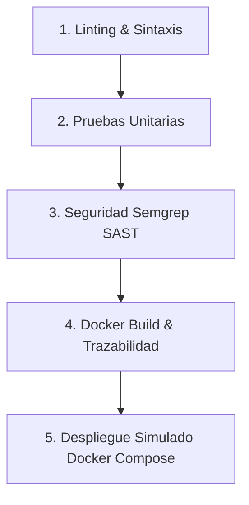

# devops-wisdom 🖥️ — Evaluación Parcial N.º 2 DevOps (DOY0101)

**devops-wisdom** es una aplicación web interactiva que genera y expone frases reflexivas sobre la cultura DevOps, control de versiones con Git, integración continua (CI/CD) y colaboración en equipos de ingeniería de software.

La interfaz simula una consola de terminal UNIX retro con monitor CRT de fósforo ámbar (`#FFB000`), renderizando cada sentencia con un efecto dinámico de escritura letra por letra (*typewriter effect*).

Este proyecto implementa los estándares de la **Evaluación Parcial N.º 2 de Ingeniería DevOps**, incorporando un pipeline integral de CI/CD automatizado, contenerización con Docker, pruebas unitarias automatizadas, análisis de seguridad estático (SAST), gobernanza de dependencias con Dependabot y orquestación reproducible con Docker Compose.

---

## ⚡ 1. Funcionalidades de la aplicación

1. **Generador dinámico de frases (`devops --quote`):** Selección aleatoria de frases evitando repeticiones consecutivas.
2. **Filtro interactivo por categorías:** Clasificación por dominios clave: `git`, `ci-cd`, `cultura`, `infraestructura` y `todas`.
3. **Comando parametrizado en terminal:** Reflejo dinámico del comando con su bandera en consola (ej. `devops --quote --category=ci-cd`).
4. **Contador en tiempo real:** Actualización del número de entradas disponibles según la categoría elegida.
5. **Botón de consola `clear`:** Limpieza instantánea de la pantalla sin recargar la aplicación.
6. **Manejo defensivo y estado sin resultados:** Sanitización de datos, detección de campos vacíos y mensaje informativo seguro ante filtros vacíos.
7. **Accesibilidad y navegación por teclado:** Atajo mediante tecla <kbd>Enter</kbd> y compatibilidad total con la directiva `prefers-reduced-motion` del sistema operativo.
8. **Diseño retro responsivo:** Monitor CRT con scanlines, efecto glow y barra de título ventana estilo 80×24.

---

## 🛠️ 2. Tecnologías utilizadas

* **Frontend:** HTML5 semántico, CSS3 moderno (Vanilla CSS) y JavaScript puro (Vanilla JS ES6+). Sin frameworks ni dependencias de ejecución.
* **Contenerización (IE1):** Docker con imagen base no privilegiada `nginxinc/nginx-unprivileged:1.27-alpine`.
* **Pruebas Automatizadas (IE2):** Runner nativo de pruebas de Node.js (`node:test` y `node:assert/strict`), sin requerir librerías externas de terceros.
* **Seguridad y Gobernanza (IE3):** Dependabot (`.github/dependabot.yml`), escaneo estático de seguridad SAST con Semgrep y compatibilidad con Snyk.
* **Integración y Despliegue Continuo (IE4):** GitHub Actions con pipeline orquestado en 5 etapas secuenciales dependientes.
* **Orquestación (IE5):** Docker Compose (`compose.yaml`) con red interna puente y healthcheck integrado.

---

## 📋 3. Requisitos previos

* [Git](https://git-scm.com/) instalado.
* [Docker Desktop](https://www.docker.com/products/docker-desktop/) (o motor de Docker en Linux) con Docker Compose v2+.
* [Node.js](https://nodejs.org/) v20+ (únicamente requerido si se desea ejecutar las pruebas unitarias localmente sin Docker).

---

## 📁 4. Estructura real del repositorio

```text
Evaluacion1Devops/
├── .github/
│   ├── dependabot.yml          # Configuración de Dependabot (Actions y Docker)
│   └── workflows/
│       └── ci.yml              # Pipeline CI/CD automatizado de 5 etapas
├── tests/
│   └── app.test.js             # Suite de pruebas unitarias automatizadas (node:test)
├── .dockerignore               # Reglas de exclusión para el build de Docker
├── Dockerfile                  # Contenedor NGINX Alpine no privilegiado (no-root)
├── compose.yaml                # Orquestación multicontenedor local con red y healthcheck
├── .gitignore                  # Exclusión de archivos locales y temporales
├── index.html                  # Estructura semántica de la terminal
├── phrases.js                  # Banco de datos de frases estructuradas
├── script.js                   # Lógica interactiva, filtros y typewriter
├── style.css                   # Estilos CRT ámbar, animaciones y responsive
└── README.md                   # Documentación técnica completa
```

---

## 🚀 5. Instalación y ejecución local (sin contenedores)

Dado que es una aplicación Vanilla JS, se puede ejecutar directamente:

* **Opción directa:** Abrir `index.html` en cualquier navegador web.
* **Servidor local estático:**
  ```bash
  # Con npx (Node.js)
  npx serve .

  # Con Python 3
  python -m http.server 8080
  ```
  Acceder a `http://localhost:8080`.

---

## 🐳 6. Contenerización con Docker (IE1)

Se diseñó un `Dockerfile` optimizado y seguro para servir archivos estáticos con NGINX en modo no root:

* **Imagen base:** `nginxinc/nginx-unprivileged:1.27-alpine` (mínima superficie de ataque, menos de 45 MB).
* **Seguridad:** El proceso de NGINX se ejecuta bajo el usuario sin privilegios `nginx` (UID 101), evitando ejecución como `root`.
* **Puerto:** Expone el puerto `8080` (puerto no privilegiado).
* **Healthcheck:** Monitoreo periódico interno con `wget --spider`.

### Comandos de Docker:
```bash
# 1. Construir la imagen Docker localmente
docker build -t devops-wisdom:v1.0 .

# 2. Ejecutar el contenedor
docker run -d --name devops-wisdom-container -p 8080:8080 devops-wisdom:v1.0

# 3. Comprobar estado y logs
docker ps
docker logs devops-wisdom-container

# 4. Detener y eliminar el contenedor
docker stop devops-wisdom-container
docker rm devops-wisdom-container
```

---

## 🧪 7. Pruebas automatizadas en el pipeline (IE2)

Las pruebas están implementadas en `tests/app.test.js` utilizando el runner nativo `node:test` de Node.js v20+, evitando dependencias externas pesadas como Jest o Mocha.

### Cobertura de las pruebas:
1. **Integridad de archivos y DOM:** Existencia de `index.html`, `style.css`, `script.js`, `phrases.js`, `Dockerfile` y selectores clave (`#screen`, `#run-btn`, `#category-filter`, etc.).
2. **Validación del banco de datos:** Comprueba que `PHRASES` sea un arreglo con al menos 10 frases válidas, con texto y autor no vacíos y clasificadas en las categorías permitidas (`git`, `ci-cd`, `cultura`, `infraestructura`).
3. **Lógica de filtrado y fallback defensivo:** Comprueba el filtrado por categoría, filtros inexistentes y comportamiento ante listas vacías o corruptas.

### Ejecución de pruebas:
```bash
# Ejecutar localmente
node --test tests/app.test.js
```
*Si alguna prueba falla, el comando emite un código de salida `1`, deteniendo inmediatamente el pipeline de CI/CD.*

---

## 🛡️ 8. Dependabot y seguridad de software (IE3)

### A. Dependabot (`.github/dependabot.yml`)
Monitorea semanalmente las versiones de los componentes utilizados:
* Ecosistema `github-actions`: Actualización de acciones oficiales (checkout, setup-node, build-push-action, etc.).
* Ecosistema `docker`: Monitoreo de parches de seguridad sobre la imagen base de NGINX Alpine.

### B. Análisis de Seguridad SAST (Semgrep & Snyk)
* **Semgrep SAST:** Análisis estático de código JavaScript en búsqueda de vulnerabilidades comunes (OWASP Top 10, XSS, inyecciones) sin requerir credenciales externas.
* **Snyk (Opcional):** Integrado mediante step condicional en GitHub Actions; si se configura el secret `SNYK_TOKEN`, ejecuta análisis de seguridad adicional.

### C. Bloqueo de la entrega (Quality Gate)
El pipeline aplica bloqueo estricto (*fail-fast*): si Semgrep detecta una vulnerabilidad crítica o si una prueba unitaria falla, el pipeline se aborta y no se avanza a la etapa de construcción de imagen ni de despliegue.

---

## 🔄 9. Pipeline CI/CD con GitHub Actions (IE4)

El archivo `.github/workflows/ci.yml` orquesta el flujo de valor completo dividido en 5 trabajos interconectados:



### Detalle de las 5 etapas:
1. **`lint-and-validate`:** Verifica la presencia de archivos requeridos, sintaxis JS con `node --check` y ausencia de dependencias (`package.json`).
2. **`unit-tests`:** Ejecuta `node --test tests/app.test.js`. Bloquea el flujo ante cualquier fallo.
3. **`security-scan`:** Ejecuta análisis estático SAST con Semgrep.
4. **`docker-build`:** Genera un tag de imagen con trazabilidad basado en el SHA corto del commit (`devops-wisdom:${SHORT_SHA}`) y compila la imagen con Docker Buildx.
5. **`deploy-simulation`:** Valida `compose.yaml`, levanta el contenedor con Docker Compose, ejecuta un smoke test verificando respuesta `HTTP 200 OK` y desmonta el entorno limpiamente.

### Triggers y ramas de activación:
* `push` hacia `develop` y `main`.
* `pull_request` dirigidos a `develop` y `main`.

---

## 📦 10. Orquestación con Docker Compose (IE5)

El archivo `compose.yaml` define el entorno de ejecución multicontenedor:

```yaml
services:
  web:
    build:
      context: .
      dockerfile: Dockerfile
    image: devops-wisdom:local
    container_name: devops-wisdom-app
    restart: unless-stopped
    ports:
      - "8080:8080"
    environment:
      - NODE_ENV=production
    healthcheck:
      test: ["CMD-SHELL", "wget --quiet --tries=1 --spider http://127.0.0.1:8080/ || exit 1"]
      interval: 15s
      timeout: 3s
      retries: 3
      start_period: 5s
    networks:
      - app-net

networks:
  app-net:
    driver: bridge
```

### Comandos de Docker Compose:
```bash
# Validar la sintaxis de compose.yaml
docker compose config

# Levantar el entorno en segundo plano
docker compose up -d --build

# Ver el estado y healthcheck
docker compose ps

# Consultar los logs
docker compose logs -f

# Detener y limpiar el entorno
docker compose down
```

---

## 👥 11. GitFlow y estrategia de colaboración

El proyecto utiliza **GitFlow** para garantizar la separación de entornos:
* `main`: Producción estable.
* `develop`: Entorno de integración continua y staging.
* `feature/pipeline-ci-cd`: Rama de funcionalidad creada para implementar los 5 indicadores de esta evaluación.
* **Pull Requests:** Toda integración a `develop` requiere pasar por un Pull Request con el pipeline de GitHub Actions en verde.

---

## 🤖 12. Declaración del uso de Inteligencia Artificial

En cumplimiento con los estándares académicos y profesionales, declaramos que se utilizó **Antigravity (Google DeepMind)** como asistente técnico de ingeniería DevOps para:
1. Diseñar el `Dockerfile` optimizado bajo estándares de no-root con NGINX Alpine unprivileged.
2. Escribir la suite de pruebas unitarias automatizadas `tests/app.test.js` bajo el runner nativo `node:test`.
3. Configurar la orquestación reproducible en `compose.yaml` y la gobernanza en `.github/dependabot.yml`.
4. Estructurar el workflow de GitHub Actions en 5 etapas secuenciales dependientes con trazabilidad y smoke testing.
5. Redactar y organizar la documentación técnica del `README.md`.

Todas las configuraciones y pruebas fueron ejecutadas y validadas técnicamente en el entorno de desarrollo.

---

## 📌 13. Conclusiones del equipo

### Benjamin Jerez
La implementación de contenedores Docker no privilegiados y la orquestación con Docker Compose facilitó que la aplicación corra de forma idéntica en cualquier máquina sin preocuparse por dependencias locales. La automatización del despliegue simulado en el pipeline garantiza que solo código que realmente levanta sea aprobado.

### Dylan Monroy
La incorporación del runner nativo de pruebas de Node.js nos permitió validar la lógica y los datos sin quebrar la política de Vanilla JS. El bloqueo automático en GitHub Actions demostró la importancia de prevenir que errores lleguen a producción.

### Nicolas Silva
La configuración de Dependabot y Semgrep como puertas de seguridad (Quality Gates) eleva el estándar del proyecto a un nivel profesional de DevOps. El proceso nos enseñó que la seguridad y la observabilidad deben integrarse desde las primeras fases del ciclo de vida del software.